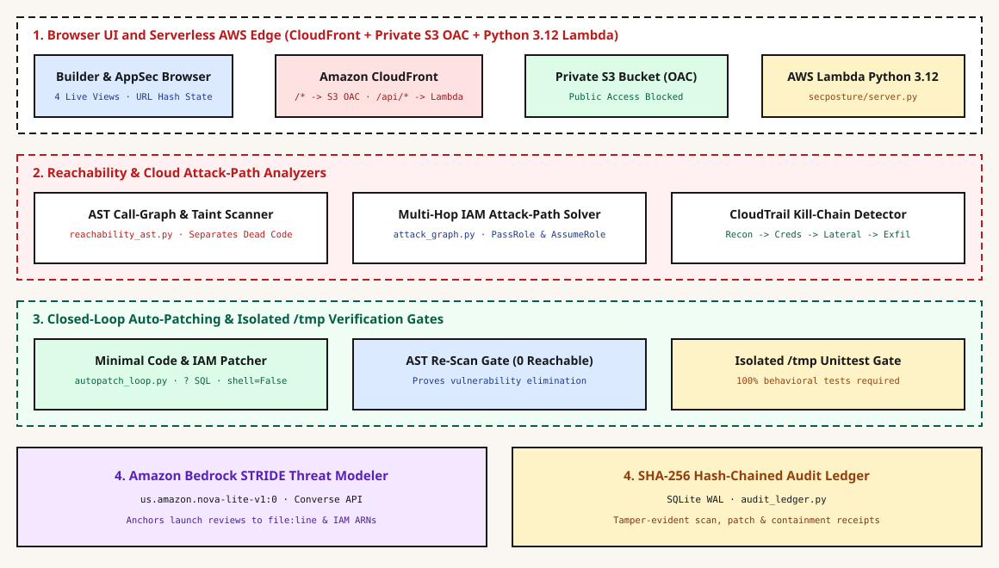

# SecPosture: AST Call-Graph Reachability, Multi-Hop IAM Attack-Path Solver & Test-Verified Auto-Patching

- **Live CloudFront Application**: Deploying via `infra/deploy_cloudfront.sh` (updated on release)
- **GitHub Repository**: https://github.com/ritwikareddykancharla/secposture-appsec

SecPosture is a Python 3.12 application security and cloud attack-path automation platform deployed on **Amazon CloudFront + Private S3 (OAC) + AWS Lambda (`python3.12`) + SQLite WAL + Amazon Bedrock (`us.amazon.nova-lite-v1:0`)** with `$0.00` idle infrastructure cost.



## 01 · Problem

Application security engineers and service builders face four recurring bottlenecks before and after launch:

1. **Alert Fatigue from Dead Code**: Regex and surface SAST rules flag uncalled legacy helper functions with the same urgency as live HTTP routes, burying genuine vulnerabilities.
2. **Siloed Code and IAM Reviews**: Reviewing Python source code separately from AWS IAM policies misses compound escalations such as an outbound URL bug inside a role holding `iam:PassRole` and `lambda:UpdateFunctionCode`.
3. **Unverified Automated Fixes**: LLM-generated patches can break service behavior or leave subtle bypasses unless gated by deterministic AST re-scans and behavioral unit tests.
4. **Single-Event CloudTrail Noise**: Alerting on isolated `AccessDenied` or `AssumeRole` events creates false positives, whereas real intrusions follow multi-stage sequences across reconnaissance, credential access, lateral movement, and data exfiltration.

## 02 · Architecture & Modules

- `secposture/reachability_ast.py`: Parses Python microservices via `ast.parse`, discovers public `@route` and `lambda_handler` entrypoints, constructs the function call graph, traces untrusted parameter taint to five sink classes (`CWE-89` SQL injection, `CWE-78` command injection, `CWE-918` SSRF, `CWE-502` `pickle.loads` deserialization, and `CWE-798` hardcoded secrets), and separates `REACHABLE_EXPLOITABLE` paths from `UNREACHABLE_DEAD_CODE` helpers.
- `secposture/attack_graph.py`: Runs Dijkstra shortest-path discovery across AWS IAM roles, trust policies (`sts:AssumeRole`), `iam:PassRole` + `lambda:UpdateFunctionCode`, `iam:AttachRolePolicy`, and wildcard `s3:GetObject` / `kms:Decrypt` edges to crown-jewel buckets and keys. Also evaluates CloudTrail event streams across `RECON -> CREDENTIAL_ACCESS -> LATERAL_MOVEMENT -> EXFILTRATION` and synthesizes least-privilege and session quarantine policies.
- `secposture/autopatch_loop.py`: Generates minimal diffs strictly on reachable vulnerable functions (`?` SQL parameter bindings, `shell=False` argv lists with metacharacter validation, `_validate_https_allowlist()` blocking private and `169.254.169.254` link-local IPs, `json.loads` replacing `pickle.loads`, and `os.environ.get` secret lookups), writes the patched code into an isolated `/tmp` workspace, re-runs the AST scanner to confirm `0` reachable vulnerabilities, and executes `python3 -m unittest` (`shell=False`) requiring `100%` passing tests.
- `secposture/threat_review.py`: Builds a 6-category STRIDE matrix anchored to exact `file:line` spans and IAM ARNs, and calls live Amazon Bedrock (`us.amazon.nova-lite-v1:0`) via the Converse API for launch decisions and pull-request security notes.
- `secposture/audit_ledger.py` & `secposture/server.py`: Records every scan, patch verification run, graph check, and threat review in an append-only SHA-256 hash-chained SQLite WAL database and serves `/api/*` behind CloudFront.

## 03 · Measured Benchmarks (`benchmarks/latest_results.json`)

Executed by `python3 benchmarks/run_benchmarks.py` in `us-west-2`:

| Metric | Measured Value | Details |
| --- | --- | --- |
| **AST Dead-Code Alert Noise Filtered** | `44.4%` (`8 / 18`) | `6` microservices scanned (`10` reachable flaws, `8` dead-code helpers) |
| **Reachable Vulnerability Recall / Precision** | `100.0%` / `100.0%` | `10 / 10` live entrypoint-to-sink paths identified |
| **AST Reachability Scan Latency (`p50` / `p95`)** | `0.509 ms` / `1.086 ms` | Python `ast` call-graph + taint propagation |
| **Closed-Loop Auto-Patch Verification Rate** | `12 / 12` (`100.0%`) | `4` vulnerable repos x `3` runs (`10 -> 0` reachable flaws) |
| **Behavioral Unit Tests Passed in `/tmp`** | `16 / 16` (`100.0%`) | Isolated `subprocess.run(..., shell=False)` `unittest` execution |
| **Auto-Patch + Unittest Loop (`p50` / `p95`)** | `67.01 ms` / `98.794 ms` | Includes AST re-scan + `/tmp` unit test suite (`64.63 ms` `unittest` `p50`) |
| **IAM Crown-Jewel Escalation Paths** | `4 -> 0` (`0.021 ms` `p50`) | Eliminated across all `4` AWS IAM account snapshots after patch |
| **CloudTrail Kill-Chain Precision / Recall** | `100.0%` / `100.0%` | `8 / 8` multi-stage intrusions caught, `0` false positives across `16` traces (`0.006 ms` `p50`) |
| **Amazon Bedrock Converse Latency (`p50` / `p95`)** | `1,104.0 ms` / `2,453.9 ms` | `8` live `us.amazon.nova-lite-v1:0` calls (`595` mean tokens, `4,760` total tokens) |
| **SQLite WAL SHA-256 Chain Verification** | `1.792 ms` | Cryptographic hash verification across `58` audit rows |

## 04 · Local Verification & Deployment

```bash
# 1. Run all 12 unit tests
python3 -m unittest discover -s tests -v

# 2. Re-run real AST, /tmp auto-patch, IAM graph, CloudTrail, and live Bedrock benchmarks
unset AWS_ACCESS_KEY_ID AWS_SECRET_ACCESS_KEY AWS_SESSION_TOKEN
AWS_PROFILE=portfolio AWS_DEFAULT_REGION=us-west-2 python3 benchmarks/run_benchmarks.py

# 3. Start local workbench at http://localhost:3099
python3 -m secposture.server

# 4. Deploy to Amazon CloudFront + Private S3 OAC + AWS Lambda Python 3.12
./infra/deploy_cloudfront.sh
```
